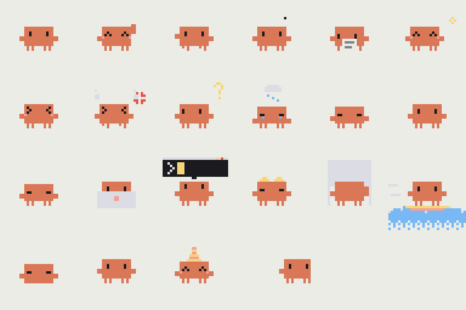
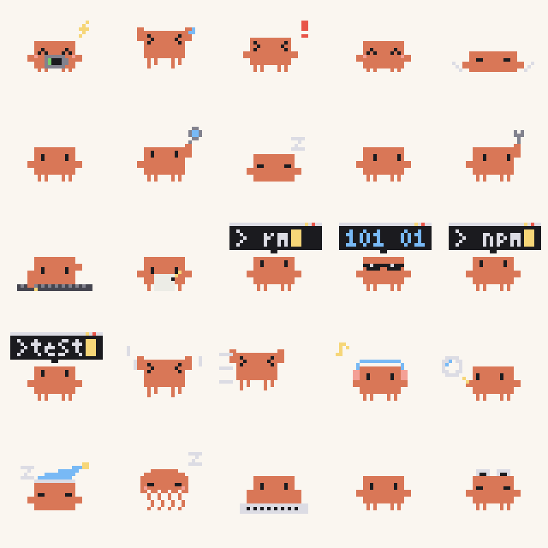

# 🦀 ClawdPet · operit-clawd

[Operit](https://github.com/AAswordman/Operit) 的像素桌宠插件：住在屏幕上的小螃蟹 Clawd。它会贴着屏幕边缘探头，你双击它就能聊天；AI 干活的时候，它会跟着思考、敲键盘、调工具。



> **非官方粉丝作品。** Clawd 是 Anthropic 旗下 Claude Code 的吉祥物，形象归 Anthropic 所有。本项目和 Anthropic 没有任何关系。

## 功能

- **悬浮桌宠**：拖动、甩飞、贴边探头、斜靠在墙上。闲着的时候会自己东张西望、看书、散步、打盹。
- **双击聊天**：输入的话会发到绑定的 Operit 对话，回复按句子拆成气泡，一条条冒出来。
- **跟随 AI 状态**：思考时托腮；调用工具时，按工具类型换成敲终端、搜索、冲浪、打字等动作；完成时开心，出错时难过。
- **戳戳反馈**：戳一下会疑惑，连戳会生气，长按会害羞。随机冒出的台词会按内容配上对应的情绪动作。
- **`<clawd>` 标签**：AI 在回复里写 `<clawd anim="wave">嗨～</clawd>`，桌面上的 Clawd 就会挥手说这句话。聊天里也会显示一张卡片，点一下可以重播。一条回复最多 3 个标签，会按顺序播放。
- **兼容 moodlet**：`<silent mood="...">` 情绪卡片会自动对应到 Clawd 的动作。
- **小档案和图鉴**：侧边栏可以查看等级和陪伴天数。聊天、被戳、熬夜等会解锁 12 个发呆小动作。

更多动作：



## 安装

1. 下载 [Release](../../releases) 里的 `clawd_pet.toolpkg`，在 Operit 里导入。
2. 授予悬浮窗权限。
3. 第一次启动时，素材会释放到 `/sdcard/Download/Operit/plugins/clawd_pet/sprites/`。设置保存在同目录的 `settings.json`。

> 这是 Operit 插件，不是独立 App，需要先装 [Operit](https://github.com/AAswordman/Operit)。

## 可用动作（`anim`）

`happy love shy dizzy annoyed error notify look reading yawn doze bubble coffee headphones sleep think typing juggling ultrathink building debugger wizard outlaw surf toast jelly talk spin walk wave`

## 目录

| 路径 | 内容 |
|---|---|
| `clawd_pet/` | ToolPkg 本体（`main.js` 主控、`assets/` 页面、`ui/` 设置、档案、标签卡片） |
| `clawd_pet/sprites/` | 32×32 横排 PNG 序列帧和 `sprites.json`（fps、hold、loop） |
| `clawd_pet/native-src/` | 悬浮窗宿主 `ClawdHost.java`，`build.sh` 用来编译成 dex |
| `tools/sprite-gen/` | 像素素材生成脚本（Python + Pillow）。所有像素是逐个点画出来的，改脚本开头的颜色常量重新跑一遍，就能换配色 |

`sprite-gen` 会生成完整的素材集，里面包括没有用上的草稿。插件实际用到的素材见 `sprites/sprites.json`。

## 编译原生宿主

```bash
cd clawd_pet/native-src && ./build.sh   # 需要 openjdk-17、android.jar(API 26)、r8.jar
```

## 协议

[AGPL-3.0](LICENSE)。代码和像素素材都用这个协议。

作者：[@watersalt0305](https://github.com/watersalt0305)（Mishio）& Claude
